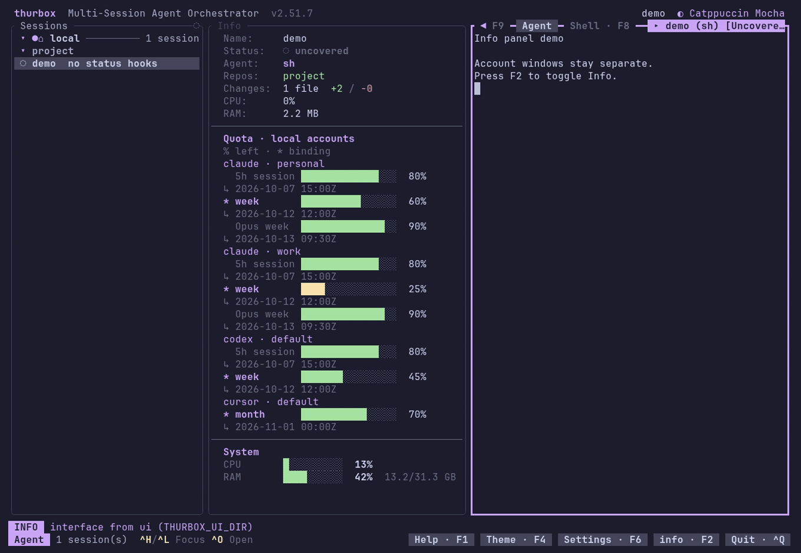

# thurbox-info-panel

Session, git, agent, account quota and system readouts beside the terminal in
[Thurbox](https://github.com/Thurbeen/thurbox). Linux and native Windows use the
same Lua pane and platform shell worker.



The recording runs a released Thurbox in its built-in Doom theme, with a
disposable profile and HOME, a demo repository and mock quota answers. No
credentials are read. Reproduce it with `vhs demo/demo.tape`, which drives
whichever `thurbox` is first on PATH.

## Install

Requires Thurbox **2.51.7 or later**. Install the pane:

```sh
thurbox-cli plugin install git+https://github.com/Thurbeen/thurbox-info-panel
```

This clones the repository into your interface directory. Add its column in
`layout.lua`, inside the `columns` block before the `center` entry:

```lua
if panels.shown("info") and filled(ctx, "info") then
  columns[#columns + 1] = { slot = "info", pct = 15, min = 28, max = 44 }
end
```

Run `thurbox-cli plugin check`, then press **F2** or click **info**. It follows
`store.selected`; it is a readout and does not take keyboard focus. The compact
layout below 36 columns drops the padded label column.

When the column is too short for everything, the whole panel scrolls: the wheel
over it moves one line per report, and the palette's **scroll the info panel
down a page** and **up a page** do the same without a mouse (bind them to keys
in your keymap if you like; the panel takes no keys of its own). The border title
reads **Info ↓**, **Info ↑↓** or **Info ↑** while more is below, on both sides or
above; the position is kept to what fits after a resize or a refresh. Theme roles follow the
selected light or dark palette.

### Account quotas

Install [quota-axi](https://github.com/kunchenguid/quota-axi), **0.1.58 or later**
(Node.js 22.19 or later), on PATH. On Windows, use native Node.js and npm:

```sh
npm install -g quota-axi
thurbox-cli extension install git+https://github.com/Thurbeen/thurbox-info-panel
```

The companion extension registers one cron automation, once a minute. Its
Node.js script asks each running local interface to refresh; no resident process
or additional quota cache is created. Without the extension, F2 and the command
palette's **refresh account quotas on all hosts** still refresh the panel.

**Grant run once:** `Ctrl+,` → `]` (Interface) → select the info-panel file →
`t`. Until you grant it, the panel says **trust run in Interface settings** and
executes nothing. After granting, press F2 twice or use the refresh command.
A missing CLI shows `npm install -g quota-axi`; a pending fetch shows **loading**.

```text
Thurbox heartbeat (once/minute)
  → refresh.mjs → local UI action
  → trusted pane action → background quota-axi worker
  → cached JSON → pure render
```

No polling, process launch or network access happens in `render`. Requests have a
60-second TTL and a 30-second timeout. JSON is decoded only when its contents or
result state change, or the snapshot crosses a minute boundary. The kernel
caches the pure render between changes.

Each configured subscription/account is labelled separately, including multiple
accounts of one provider, and every window it reports gets its own gauge, after
fleet's queue-pane FUEL rows:

```text
  Quota left · local accounts             3m ago
  claude · personal
    5h session      ━━━━━━━━━━──  80%  ↻ 3h
    week            ━━━━━━━─────  60%  ↻ 1d 5h
    Opus model week ━━━━━━━━━━━─  90%  ↻ 5d 21h
  codex                      binding unavailable
    session         ━━━━────────  33%  ↻ <1m
    week            ━━━━━───────  45%
```

Session, week and model-specific windows stay separate, at every width and in
quota-axi's order; no providers, accounts or windows are summed together. Labels
of binding windows (quota-axi's schema 5/6 `quotaSemantics.effectiveAvailability`)
are drawn in the bold accent; tied and model-scope bindings are preserved, and a
subscription without authoritative binding metadata says **binding unavailable**.
Bars start, and numbers end, in one column across the block.

Times are compact countdowns and ages: the two largest units, floored, with no
seconds (`<1m`, `45m`, `5h`, `23h 59m`, `1d 5h`, `10d`, and from a hundred days
only `144d`; `now` once due). A reset quota-axi gives only as text is shown as
given. The reading's age appears beside the heading only once a refresh is
overdue (over 90 seconds old).

When a bar would be shorter than eight cells beside its label, as in the compact
layout, each window takes two lines: its label with the reset at the right, then
a gauge across the column. Gauge colours use the active theme's good, warning
and danger roles: remaining above 40%, above 15% through 40%, and 15% or less.

Claude, Codex, Cursor, Copilot, Z.AI, Antigravity and other discovered providers
use the same path. Gemini model windows are shown when quota-axi reports them
through Antigravity; the panel does not invent a standalone Gemini adapter.
Providers positively marked `notSetUp` are omitted. Each window uses only its own
measured `percentRemaining`; missing or untrusted readings show **unavailable**,
and stale readings show **stale**, without a number or bar. A failed fetch says
why after **unavailable**: the run did not finish, timed out, had its output
truncated, or exited non-zero (with the first line of its error, cleaned of
terminal escapes and cut to 120 characters), or its output was unreadable or of
an unsupported schema. Cached reports older than five minutes relative to the
snapshot are marked stale. Account emails from the report are not displayed.

### Remote host quotas

Every host in Thurbox's `hosts.toml` gets its own block below the local one,
**Quota left · remote · <host>**, in `hosts.toml` order, however many there
are; scroll the panel to reach the later ones. Each refresh asks this machine
and every configured host at once, each with its own 30-second timeout, with
`quota-axi --json --no-credential-refresh`, so a quota refresh never renews a
credential. Install quota-axi on each host the same way.

```text
refresh action → run_forget(retired host keys)
  → run("quota",            machine = "local")
  → run("quota.host:<name>", machine = "host:<name>")  one per configured host
  → Thurbox's own SSH/WSL transport → cached answers → pure render
```

Hosts need no session and no `share_sessions`. Readings are never pooled: each
host's block shows only that host's report. Its title line ends in the host's
state, so a long list reads at a glance:

| State | Meaning |
| --- | --- |
| **ok** | a fresh report; its gauges follow |
| **checking** | the first answer is still on its way |
| **offline** | unreachable or no answer within the timeout |
| **auth needed** | reachable, but no provider is logged in |
| **stale · 3h old** | the host's report is older than five minutes |
| **no quota-axi** | quota-axi is not installed there |
| **error** | quota-axi failed or printed something unreadable |

A host that is not ok takes one line under its title, saying why, and holds up
none of the others. A host that answered once keeps its last gauges when it
drops off, as **offline · 12m old**. When a host leaves `hosts.toml`, the next refresh
forgets its answer and any queued request (Thurbox reads `hosts.toml` at start).
A command already running on a host is not cancelled; Thurbox's own timeout and
concurrency limits bound it.

Remote hosts need **Thurbox 2.66.0 or later**, which adds the
`machine = "host:<name>"` selector and `run_forget`
([#1547](https://github.com/Thurbeen/thurbox/pull/1547)). Older Thurbox keeps the previous behaviour: local accounts are read
in the selected session when it is local, otherwise in the first local one,
**needs a local session** is shown when there is none, and each host block says
**host quota API unavailable**.

Remove the scheduler with `thurbox-cli extension uninstall info-panel-refresh`;
remove the pane with `thurbox-cli plugin remove info_panel` and remove the layout
entry. Plugin updates use `thurbox-cli plugin update`.

## Other readouts

| Section | Source |
| --- | --- |
| Session, parent, host, activity and signal | selected session snapshot |
| Repositories, base, changes and sync | session directories and git snapshot |
| Process CPU and RAM | `metrics.sessions[id]` |
| Agent cost, tokens, context, time, cache and lines | optional agent statusline metrics |
| System CPU and RAM | `metrics.system` |
| Enabled automations and schedules | `thurbox.automations` |

Absent metrics are omitted. Process CPU can exceed one core, so it is a plain
percentage rather than a capped gauge. The old agent/host-specific usage section
is replaced by the account quota section. All widths are measured with Thurbox's
injected `text` API, including wrapping and truncation.

## Development

```sh
bash scripts/check.sh
```

The gate bootstraps an isolated release interface under `.cache/`, runs StyLua,
Selene and rumdl, renders fixtures at wide/compact widths, sweeps the preview
scenarios and drives a real TUI with tmux. It needs Python 3, Node.js, Lua 5.4 or later,
Thurbox and those tools on PATH. Tests never grant a capability or change the
live interface. JSON fixtures cover several providers, two accounts, individual
session/weekly/model windows,
unavailable, untrusted and stale readings; render tests cover 28, 44 and 80 columns and forbid worker
requests from drawing. `tests/snapshots/` pins the quota section at 50 and 30 columns
(`lua tests/snapshot.lua .cache/check/ui --update` rewrites them), and
`tests/format.lua` pins the duration format at its boundaries.
Native Windows CI installs and checks the same plugin.

With `INFO_PANEL_CORE_BIN` naming a directory holding a `thurbox` and
`thurbox-cli` of 2.66.0 or later, the gate also runs
`tests/remote-smoke.py`: a disposable HOME, profile and tmux socket, five
`hosts.toml` hosts with `share_sessions = false` behind a fake `ssh` and a fake
quota-axi, and no sessions. It grants run through the TUI's own settings and
checks that local and remote readings stay distinct, that a slow host times out
without holding up the others, that offline, missing and unreadable hosts say so,
and that the 60-second TTL sends one command per host. Text and ANSI frames go to
`.cache/remote-smoke/`.

`thurbox.yml` is the release sandbox contract. Host scripts use
`dev/selene.toml`. For a plain-text preview:

```sh
lua dev/preview.lua .cache/check/ui 28 full
```

CI runs on pull requests. Renovate maintains pinned actions
with a seven-day release age. Versioned releases follow conventional commit
subjects (`feat:`, `fix:`, `docs:`); the release tag and `plugin.toml` version must
agree. This change does not publish a release.

## Manual test

Install the PR revision in a disposable interface, place the column as above,
and run `thurbox-cli plugin check`. Open Thurbox, press F2 and grant run in the
Interface tab. With quota-axi on PATH, use the refresh palette command: each
configured account should show a gauge, percentage and reset countdown for every
window at 44 columns, with binding labels highlighted, or an honest status word.
At 28 columns, each window should take two lines and still be listed. Install
the companion extension and leave the interface idle
across a minute boundary; its quota answer should refresh without switching
sessions. Hide Info with F2 and show it again. Resize the column to 28 and 44
columns and select a light and a dark theme in Settings: labels, bars and borders
should remain within the column. Uninstall quota-axi in the disposable environment
and refresh: the install command should replace the quota data. The GIF above
shows the mock-data visual path; live provider access requires your own grant.

For remote hosts, run Thurbox 2.66.0 or later (see
[Remote host quotas](#remote-host-quotas)) with one or more `hosts.toml` hosts
that have quota-axi installed, and use the refresh palette command with no session
open: each host should get its own **Quota left · remote · <host>** block with
its own readings, beside the local block. An unreachable host should say
**offline** and why, while the others still show gauges. With four or more
hosts, scroll down: the fourth host's block is there too. Remove a host from
`hosts.toml` and restart Thurbox: its block disappears. On a Thurbox release
before 2.66.0, each host block says **host quota API unavailable** and
the local block behaves as before.

For scrolling, shrink the terminal or the column until the title shows
**Info ↓**, scroll the wheel over the panel to the last section (**System** or
**Automations**) and back to the first, then use **scroll the info panel down a
page** from the palette. Make the terminal tall again: the title goes back to
**Info**.

## License

MIT — see [LICENSE](LICENSE). The JSON decoder is adapted from
[thurbox-auto-continue](https://github.com/Thurbeen/thurbox-auto-continue) (MIT).
